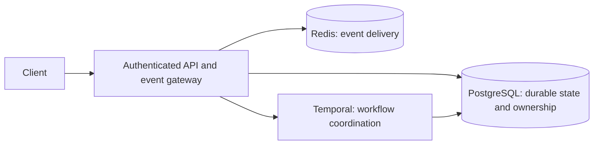

# Reliability architecture

SAMS uses PostgreSQL for durable task, ownership, session, and approval state. Redis carries transient event delivery state. Temporal coordinates long-running workflows. The application is private; the diagram shows the boundaries relevant to the public claims.

## Failure contracts

| Failure | Required observable outcome |
| --- | --- |
| Event history is missing or has reset | Return an explicit incomplete-sync outcome; never claim a complete replay. |
| New events arrive while a client reconnects | Deliver the replay interval and subsequent live events in order, with no silent gap or duplicate at the boundary. |
| Two people decide concurrently | One durable decision wins; the other observes a conflict. |
| Decision is stored but workflow wake-up is lost | The workflow rereads durable state and proceeds from the stored decision. |
| Decision races the deadline | Both paths arbitrate against the same durable decision record. |
| An event claims a tenant | The claim is not authority; ownership is resolved from trusted stored state. Unknown ownership withholds delivery. |
| A refresh token is reused | Reuse invalidates the session family. |

These contracts are intentionally stated without production Lua, SQL, lock order, endpoint topology, schema, or token internals. The [verification matrix](VERIFICATION.md) distinguishes observed test evidence from design intent.
